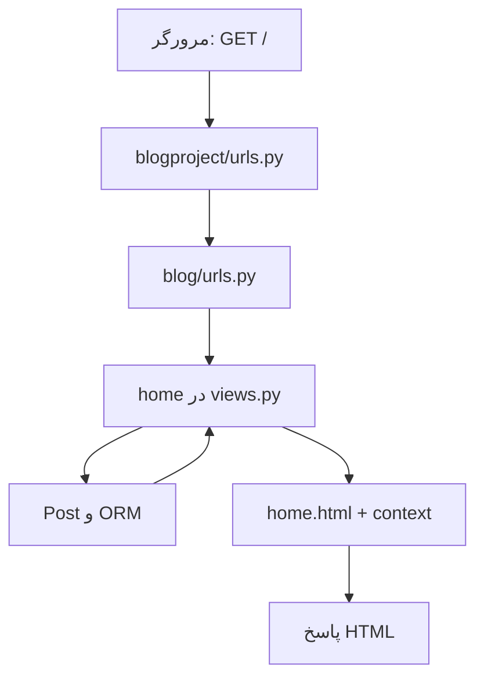

# جزوهٔ پروژه‌محور View و Template در Django

> پروژهٔ مرجع: `blogApp`، اپلیکیشن `blog`، مدل `Post`  
> سطح: مقدماتی تا کاربردی | پیش‌نیاز: آشنایی اولیه با Python، HTML و مدل Django

در این جزوه، دو صفحهٔ واقعی پروژه را از لحظهٔ ورود درخواست تا تولید HTML دنبال می‌کنیم: صفحهٔ فهرست نوشته‌ها در `/` و صفحهٔ یک نوشته در `/post/<id>/`. کدهای بخش «وضعیت فعلی پروژه» همان رفتار نسخهٔ تحویلی پروژه را نشان می‌دهند. کدهای بخش «تمرین و توسعه» پیشنهادهایی هستند که هنوز در پروژه اعمال نشده‌اند.

## فهرست

1. [آماده‌سازی و نقشهٔ پروژه](#۱-آمادهسازی-و-نقشهٔ-پروژه)
2. [جریان یک درخواست در MVT](#۲-جریان-یک-درخواست-در-mvt)
3. [URL و اتصال آن به View](#۳-url-و-اتصال-آن-به-view)
4. [View فهرست نوشته‌ها](#۴-view-فهرست-نوشتهها)
5. [View جزئیات و مدیریت 404](#۵-view-جزئیات-و-مدیریت-404)
6. [پیدا شدن Template و Context](#۶-پیدا-شدن-template-و-context)
7. [خواندن و ساختن قالب فهرست](#۷-خواندن-و-ساختن-قالب-فهرست)
8. [خواندن و ساختن قالب جزئیات](#۸-خواندن-و-ساختن-قالب-جزئیات)
9. [قواعد مهم زبان قالب Django](#۹-قواعد-مهم-زبان-قالب-django)
10. [اجرای گام‌به‌گام، عیب‌یابی و تمرین](#۱۰-اجرای-گامبهگام-عیبیابی-و-تمرین)

## ۱. آماده‌سازی و نقشهٔ پروژه

پس از باز کردن ZIP پروژه، وارد پوشهٔ `blogApp` شوید:

```bash
python -m venv .venv
# Linux / macOS
source .venv/bin/activate
# Windows PowerShell
# .venv\Scripts\Activate.ps1
pip install -r requirements.txt
python manage.py migrate
python manage.py seed_data
python manage.py runserver
```

مرورگر را روی `http://127.0.0.1:8000/` باز کنید. فایل `db.sqlite3` داخل بسته از قبل سه کاربر و شش نوشته دارد؛ اجرای دوبارهٔ `seed_data` نمونه‌های تکراری نمی‌سازد. `migrate` نیز در پایگاه دادهٔ آماده تغییری ایجاد نمی‌کند. صفحهٔ مدیریت در `/admin/` است؛ برای ورود مدیریتی باید `python manage.py createsuperuser` را اجرا کنید.

فایل‌های مورد استفادهٔ این جزوه:

```text
blogApp/
├── blogproject/
│   ├── settings.py           # ثبت اپ و تنظیم موتور قالب
│   └── urls.py               # مسیرهای اصلی پروژه
├── blog/
│   ├── models.py             # مدل Post
│   ├── urls.py               # مسیرهای اپ
│   ├── views.py              # منطق دو صفحه
│   └── templates/
│       └── blog/
│           ├── home.html     # فهرست نوشته‌ها
│           └── detail.html   # جزئیات یک نوشته
├── db.sqlite3                # داده‌های نمونه
└── manage.py
```

مدل این پروژه چهار دادهٔ اصلی دارد: `title`، `content`، `author` و `created_at`. فیلد `author` به User پیش‌فرض Django وصل است. `Post` نام کلاس مدل است؛ آن را با روش HTTP `POST` اشتباه نگیرید. هر دو صفحهٔ فعلی با درخواست HTTP `GET` نمایش داده می‌شوند.

## ۲. جریان یک درخواست در MVT

در Django، **Model** داده و رابطه‌ها را تعریف می‌کند؛ **View** درخواست را می‌گیرد، دادهٔ لازم را فراهم می‌کند و پاسخ می‌سازد؛ **Template** داده را به HTML قابل نمایش تبدیل می‌کند. URLconf مسیر درخواست را به View مناسب وصل می‌کند.



برای نمونه، در درخواست `GET /`، تابع `home` فهرست نوشته‌ها را آماده می‌کند؛ قالب `home.html` برای هر نوشته یک کارت می‌سازد و Django نتیجه را در یک `HttpResponse` به مرورگر برمی‌گرداند. در `GET /post/1/` نیز مقدار `1` از URL به تابع `detail` فرستاده می‌شود. اگر نوشته پیدا نشود، پاسخ 404 تولید می‌شود.

**تمایز مهم:** View همان تابع Python است؛ Template فایل HTML با دستورهای زبان قالب Django است؛ URL به‌تنهایی داده‌ای از پایگاه داده نمی‌خواند.

## ۳. URL و اتصال آن به View

در `blogproject/urls.py`، مسیر خالی درخواست‌ها را به URLهای اپ می‌فرستد:

```python
from django.contrib import admin
from django.urls import include, path

urlpatterns = [
    path("admin/", admin.site.urls),
    path("", include("blog.urls")),
]
```

در `blog/urls.py` دو مسیر تعریف شده‌اند. نمایش زیر از نظر عملکرد با کد کوتاه موجود در فایل برابر است:

```python
from django.urls import path
from . import views

app_name = "blog"

urlpatterns = [
    path("", views.home, name="home"),
    path("post/<int:pk>/", views.detail, name="detail"),
]
```

| URL در مرورگر | الگوی اپ | تابع View | نام مسیر |
|---|---|---|---|
| `/` | `""` | `home(request)` | `blog:home` |
| `/post/1/` | `"post/<int:pk>/"` | `detail(request, pk=1)` | `blog:detail` |

`<int:pk>` فقط عدد صحیح مثبت را به‌عنوان بخش مسیر می‌پذیرد و آن را با نام `pk` به View می‌دهد. `pk` کوتاه‌شدهٔ *primary key* یا کلید اصلی است. وقتی الگو اصلاً با آدرس سازگار نباشد، URL resolver پاسخ 404 می‌دهد؛ وقتی عدد معتبر باشد ولی آن نوشته وجود نداشته باشد، `get_object_or_404` در View پاسخ 404 می‌سازد.

`app_name = "blog"` فضای نام مسیرها را تعیین می‌کند. بنابراین در قالب از `` استفاده می‌کنیم. اگر بعدها اپ دیگری هم مسیری به نام `detail` داشته باشد، نام کامل `blog:detail` ابهام را برطرف می‌کند. `name="detail"` به ما اجازه می‌دهد بدون نوشتن آدرس ثابت، URL را از نام مسیر بسازیم.

> اگر الگوی URL را به `<int:id>` تغییر دهید، باید نام آرگومان تابع را نیز `id` کنید یا آن را با یک wrapper تبدیل کنید. در این پروژه هر دو طرف از `pk` استفاده می‌کنند.

## ۴. View فهرست نوشته‌ها

کد موجود در `blog/views.py`:

```python
from django.shortcuts import get_object_or_404, render
from .models import Post

def home(request):
    posts = Post.objects.select_related("author").all()
    return render(request, "blog/home.html", {"posts": posts})
```

این تابع را خط‌به‌خط بخوانیم:

1. `request` شیء درخواست است. Django پس از تطبیق URL آن را به تابع می‌دهد. این صفحه در حال حاضر از ویژگی‌هایش، مانند `request.GET`، استفاده نمی‌کند.
2. `Post.objects` مدیر مدل و نقطهٔ شروع Queryهای ORM است.
3. `.all()` یک `QuerySet` از همهٔ نوشته‌ها می‌سازد. در مدل `Post`، گزینهٔ `ordering = ["-created_at"]` تنظیم شده است؛ بنابراین نوشته‌های تازه‌تر اول می‌آیند.
4. `select_related("author")` دادهٔ نویسنده را با همان Query و از راه JOIN می‌گیرد. قالب برای هر نوشته به `post.author` نیاز دارد. این روش از اجرای Query اضافه برای هر نویسنده جلوگیری می‌کند.
5. دیکشنری `{"posts": posts}` همان **context** است: کلید `posts` نام متغیری خواهد بود که قالب می‌بیند.
6. `render(...)` قالب را با context پردازش می‌کند و یک پاسخ HTML، یعنی `HttpResponse`، برمی‌گرداند. وضعیت پاسخ در حالت موفق 200 است.

ساخت `QuerySet` عموماً تنبل است: در این مثال Query هنگام پیمایش `posts` در قالب اجرا می‌شود. این رفتار باعث می‌شود بتوان پیش از اجرای Query شرط یا مرتب‌سازی بیشتری به آن افزود. نیازی نیست برای فرستادن داده به قالب حتماً آن را با `list(...)` تبدیل کنیم.

`select_related` برای رابطهٔ تک‌مقداری مانند `ForeignKey` نویسنده مناسب است. اگر بعدها رابطه‌ای چندمقداری مانند `tags` داشته باشیم، معمولاً `prefetch_related` ابزار مناسب آن رابطه است.

### آزمایش رفتار View فهرست

در Shell تعداد داده‌ها را ببینید:

```bash
python manage.py shell
```

```python
from blog.models import Post
Post.objects.count()  # در داده‌های اولیه: 6
Post.objects.order_by("-created_at").values_list("title", flat=True)
```

سپس صفحهٔ `/` را باز کنید. عنوان‌هایی که در Shell دیده‌اید باید به صورت لینک در صفحه ظاهر شوند. برای بررسی دقیق SQL می‌توانید در Shell این عبارت را اجرا کنید:

```python
print(Post.objects.select_related("author").all().query)
```

عبارت چاپ‌شده Query برنامه‌ریزی‌شده را نشان می‌دهد و شامل اتصال جدول نوشته و کاربر است؛ خود `print(query)` لزوماً رکوردها را واکشی نمی‌کند.

## ۵. View جزئیات و مدیریت 404

تابع دوم در `blog/views.py`:

```python
def detail(request, pk):
    post = get_object_or_404(Post.objects.select_related("author"), pk=pk)
    return render(request, "blog/detail.html", {"post": post})
```

تفاوت‌های این صفحه با فهرست:

- `pk` از URL می‌آید؛ مثلاً آدرس `/post/1/` مقدار `1` را به تابع می‌رساند.
- این View تنها یک `Post` را می‌خواهد؛ به همین دلیل نام متغیر context آن `post` است، نه `posts`.
- `get_object_or_404(queryset, pk=pk)` در صورت پیدا شدن رکورد، شیء را می‌دهد و در صورت نبودن آن، استثنای `Http404` ایجاد می‌کند. Django آن را به پاسخ 404 تبدیل می‌کند.
- `select_related("author")` نام نویسنده را نیز در همان Query آماده می‌کند.

اگر به‌جای آن از `Post.objects.get(pk=pk)` استفاده کنیم و رکوردی وجود نداشته باشد، خطای `Post.DoesNotExist` رخ می‌دهد. بدون مدیریت این خطا، کاربر در حالت معمول به صفحهٔ خطای سرور می‌رسد. `get_object_or_404` برای صفحهٔ عمومی انتخاب مناسبی است.

در نسخهٔ پروژه، صفحهٔ عمومی تمام نوشته‌ها را نشان می‌دهد و مفهوم «پیش‌نویس» وجود ندارد؛ پس هر شناسهٔ موجود قابل مشاهده است. افزودن وضعیت انتشار نیازمند تغییر مدل و فیلتر View است، نه صرفاً پنهان کردن لینک در Template.

## ۶. پیدا شدن Template و Context

در `blogproject/settings.py`، گزینهٔ `APP_DIRS` برابر `True` است. بنابراین Django در پوشهٔ `templates` اپ‌های نصب‌شده به دنبال قالب می‌گردد. چون `blog` در `INSTALLED_APPS` ثبت شده، مسیر زیر پیدا می‌شود:

```text
نامی که View می‌فرستد:   blog/home.html
فایل واقعی:             blog/templates/blog/home.html
```

پوشهٔ داخلی `blog` یک فضای نام برای فایل‌های قالب است. اگر اپ دیگری هم فایلی به نام `home.html` داشته باشد، `blog/home.html` روشن می‌کند کدام فایل منظور است.

`render` را می‌توان به صورت زیر تصور کرد:

```python
render(request, "نام/قالب.html", {"نام_متغیر": مقدار})
```

برای صفحهٔ فهرست، متغیر `posts` و برای صفحهٔ جزئیات، متغیر `post` فرستاده می‌شود. نام کلیدهای context باید با نام‌هایی که داخل قالب نوشته‌ایم سازگار باشد. مثلاً اگر در View کلید را به `articles` تغییر دهیم ولی در Template همچنان `` بماند، فهرست مورد انتظار نمایش داده نمی‌شود.

در واقع `render` یک `HttpResponse` برمی‌گرداند که بدنه‌اش HTML رندرشده است. پارامتر اختیاری `status` نیز دارد؛ مثلاً `render(request, "blog/home.html", context, status=200)`. در این پروژه همان مقدار پیش‌فرض 200 کافی است. اگر قرار باشد کاربر به URL دیگری فرستاده شود، ابزار دیگری مانند `redirect` به‌کار می‌رود؛ نمایش فهرست و جزئیات فعلی به redirect نیاز ندارد.

به‌طور پیش‌فرض، قالب Django یک زبان محدود برای نمایش است. پردازش درخواست، انتخاب رکوردها و قواعد دسترسی را در View نگه دارید و از قالب برای ساختار HTML و نمایش داده استفاده کنید.

## ۷. خواندن و ساختن قالب فهرست

فایل `blog/templates/blog/home.html` در پروژه برای کوتاه بودن در چند خط فشرده نوشته شده است. کد زیر همان بخش‌های اصلی آن را با فاصله‌گذاری خواناتر نشان می‌دهد:

```html
<!doctype html>
<html lang="fa" dir="rtl">
<head>
  <meta charset="utf-8">
  <meta name="viewport" content="width=device-width, initial-scale=1">
  <title>وبلاگ آموزشی Django</title>
  <!-- در فایل پروژه، قواعد CSS همین‌جا در <style> آمده‌اند. -->
</head>
<body>
  <header>
    <h1>وبلاگ آموزشی Django</h1>
    <p>فهرست نوشته‌هایی که از مدل Post خوانده شده‌اند.</p>
    <a href="/admin/">ورود به پنل مدیریت</a>
  </header>

  
    <article class="card">
      <h2>
        <a href="">{{ post.title }}</a>
      </h2>
      <p class="meta">
        نویسنده: {{ post.author.get_full_name|default:post.author.username }}
        · {{ post.created_at|date:"Y/m/d H:i" }}
      </p>
      <p>{{ post.content|truncatewords:24 }}</p>
      <a href="">ادامهٔ مطلب ←</a>
    </article>
  
    <p>هنوز نوشته‌ای ثبت نشده است. دستور
      <code>python manage.py seed_data</code> را اجرا کنید.</p>
  
</body>
</html>
```

### حلقه و حالت خالی

`` روی QuerySet می‌چرخد. در هر بار، `post` یک شیء `Post` است. اگر QuerySet خالی باشد، بخش `` اجرا می‌شود. بنابراین کاربر به جای صفحهٔ بی‌محتوا، راهنمای افزودن داده را می‌بیند. پایان حلقه باید `` باشد.

### چاپ مقدار و فیلترها

`{{ post.title }}` عنوان را به HTML اضافه می‌کند. `{{ post.content|truncatewords:24 }}` خلاصه‌ای با حداکثر ۲۴ کلمه می‌سازد. این فیلتر محتوای خود رکورد را در پایگاه داده کوتاه نمی‌کند؛ فقط نحوهٔ نمایش آن در این نقطه از قالب را تغییر می‌دهد. متن کامل در صفحهٔ جزئیات نمایش داده می‌شود.

`post.author.get_full_name` متد کاربر را بدون نوشتن `()` در قالب فراخوانی می‌کند. اگر نام و نام خانوادگی خالی باشند، فیلتر `default:post.author.username` نام کاربری را نشان می‌دهد. متدهایی که برای اجرا به آرگومان نیاز دارند را نمی‌توان به همین شکل از قالب صدا زد.

`date:"Y/m/d H:i"` زمان را به شکل سال/ماه/روز و ساعت:دقیقه قالب‌بندی می‌کند. تنظیم پروژه `TIME_ZONE = "Asia/Tehran"` و `USE_TZ = True` است؛ هنگام رندر تاریخ در قالب، Django زمان را در منطقهٔ زمانی فعال نمایش می‌دهد. این فیلتر فقط ظاهر تاریخ را عوض می‌کند و به‌تنهایی تاریخ را به تقویم شمسی تبدیل نمی‌کند.

### لینک پویا به جزئیات

```django

```

تگ `url` با نام مسیر و شناسهٔ نوشته، آدرس می‌سازد. برای `post.pk == 1` نتیجه `/post/1/` خواهد بود. اگر الگوی URL بعدها عوض شود، با ثابت ماندن نام مسیر، لینک‌های قالب طبق الگوی جدید ساخته می‌شوند. اگر نام مسیر را اشتباه بنویسید، Django معمولاً خطای `NoReverseMatch` می‌دهد.

### HTML و راست‌به‌چپ

`lang="fa"` زبان سند را مشخص می‌کند، `dir="rtl"` جهت نمایش را راست‌به‌چپ می‌گذارد و `<meta charset="utf-8">` نمایش متن فارسی را ممکن می‌کند. عنصر `<article>` برای هر نوشته یک واحد محتوایی است؛ CSS موجود در فایل پروژه فقط ظاهر کارت‌ها را تنظیم می‌کند و نقشی در واکشی داده ندارد.

## ۸. خواندن و ساختن قالب جزئیات

نمای خواناتر از بخش اصلی `blog/templates/blog/detail.html`:

```html
<!doctype html>
<html lang="fa" dir="rtl">
<head>
  <meta charset="utf-8">
  <meta name="viewport" content="width=device-width, initial-scale=1">
  <title>{{ post.title }}</title>
  <!-- فایل پروژه CSS صفحه را در <style> قرار داده است. -->
</head>
<body>
  <p><a href="">← بازگشت به فهرست</a></p>
  <article>
    <h1>{{ post.title }}</h1>
    <p class="meta">
      نویسنده: {{ post.author.get_full_name|default:post.author.username }}
      · {{ post.created_at|date:"Y/m/d H:i" }}
    </p>
    <p>{{ post.content|linebreaks }}</p>
  </article>
</body>
</html>
```

اینجا `post` یک شیء است؛ به حلقه نیاز نداریم. `<title>` عنوان تب مرورگر را از دادهٔ همان نوشته می‌گیرد. لینک بازگشت با نام مسیر `blog:home` ساخته می‌شود. `linebreaks` شکست خط‌های متن را به پاراگراف و `<br>` مناسب تبدیل می‌کند؛ نتیجه را در قالب HTML می‌بینیم، اما محتوای ورودی همچنان escape می‌شود. اگر کاربری در محتوای نوشته `<script>` وارد کند، آن را نباید صرفاً با `|safe` اجرا کرد.

**نکتهٔ دقیق دربارهٔ HTML پروژه:** در فایل فعلی، `{{ post.content|linebreaks }}` داخل یک `<p>` قرار گرفته است. خود فیلتر `linebreaks` می‌تواند تگ `<p>` تولید کند؛ بنابراین برای HTML معتبر، در پروژه آن خط را به `<div>{{ post.content|linebreaks }}</div>` تغییر دهید. راه دیگر نگه داشتن `<p>` و استفاده از فیلتر `linebreaksbr` است که تنها شکست خط را به `<br>` تبدیل می‌کند.

در این پروژه عنوان و متن نوشته ممکن است از Admin یا Shell وارد شوند. **Autoescape** پیش‌فرض Django مانع می‌شود متن‌هایی مانند `<script>` هنگام چاپ عادی با `{{ ... }}` به‌عنوان کد HTML اجرا شوند. از `|safe` فقط زمانی استفاده کنید که HTML ورودی واقعاً با روش معتبر پاک‌سازی و قابل اعتماد شده باشد. برای این وبلاگ ساده نیازی به آن نداریم.

## ۹. قواعد مهم زبان قالب Django

| شکل | کاربرد | نمونه از پروژه |
|---|---|---|
| `{{ variable }}` | درج مقدار | `{{ post.title }}` |
| `` | کنترل نمایش یا ساخت URL | `` |
| `\|filter` | تغییر نمایش مقدار | `{{ post.content\|truncatewords:24 }}` |
| `{# comment #}` | توضیح در خود قالب | `{# عنوان نوشته #}` |

چند قاعدهٔ عملی:

1. هر متغیری که قالب لازم دارد باید از context یا پردازنده‌های context فراهم شود. برای دادهٔ خاص صفحه، آن را صریح در View بفرستید.
2. `{{ ... }}` برای چاپ است؛ `` برای فرمان‌هایی مانند `for`، `if` و `url`. نوشتن `{{ url ... }}` یا `` درست نیست.
3. فیلترها از چپ به راست به مقدار اعمال می‌شوند. مثلاً `{{ post.title|upper }}` فقط نمایش عنوان را بزرگ می‌کند.
4. دسترسی نقطه‌ای مانند `post.author.username` از فیلد، ویژگی، کلید یا فراخوانی مجاز بدون آرگومان استفاده می‌کند. این دستور، کد Python دلخواه را اجرا نمی‌کند.
5. نبودن یک متغیر در بسیاری از حالت‌ها در خروجی عادی به رشتهٔ خالی تبدیل می‌شود؛ بنابراین غلط‌های املایی در نام context ممکن است بی‌سروصدا محتوای صفحه را حذف کنند. نام‌ها را دقیق بررسی کنید.
6. از فیلتر `default` برای مقدار خالی و از `default_if_none` فقط برای `None` استفاده می‌شود. در این پروژه `get_full_name` اگر نامی نباشد رشتهٔ خالی می‌دهد، پس `default` مناسب است.

### مسئولیت View و Template را چگونه تقسیم کنیم؟

این سؤال را روی پروژهٔ خودمان بپرسید: «همهٔ پست‌ها را از کجا می‌آوریم؟» پاسخ در View و ORM است. «برای هر پست عنوان را داخل لینک چگونه نشان می‌دهیم؟» پاسخ در Template است. «پست ناموجود چه وضعیتی دارد؟» View با `get_object_or_404` آن را مدیریت می‌کند. «وقتی فهرست خالی است چه متنی ببینیم؟» Template با `` تعیین می‌کند.

### توسعهٔ اختیاری: قالب پایه و وراثت

در نسخهٔ فعلی پروژه هر صفحه `html`، `head` و `body` خودش را دارد. وقتی تعداد صفحات زیاد شود، می‌توان بخش مشترک را در `blog/templates/blog/base.html` گذاشت. نمونهٔ کوچک:

```html
<!doctype html>
<html lang="fa" dir="rtl">
<head>
  <meta charset="utf-8">
  <meta name="viewport" content="width=device-width, initial-scale=1">
  <title>وبلاگ</title>
  <style>body { font-family: Tahoma, sans-serif; max-width: 850px; margin: auto; }</style>
</head>
<body>
  <nav><a href="">فهرست نوشته‌ها</a></nav>
  <main></main>
</body>
</html>
```

در این روش باید اسکلت تکراری `<!doctype html>` تا `</html>` را از هر قالب فرزند حذف و محتوای مخصوص همان صفحه را داخل block گذاشت. برای نمونه، قالب جزئیات می‌تواند چنین شروع شود:

```django

{{ post.title }}

  <article>
    <h1>{{ post.title }}</h1>
    <div>{{ post.content|linebreaks }}</div>
  </article>

```

`extends` باید نخستین تگ قالب باشد. `block` محل‌هایی را مشخص می‌کند که فرزند پر می‌کند. برای حفظ نام نویسنده و تاریخ، خطوط فعلی قالب جزئیات را نیز داخل block `content` منتقل کنید. این تغییر یک تمرین توسعه است و در فایل‌های نسخهٔ فعلی انجام نشده است.

## ۱۰. اجرای گام‌به‌گام، عیب‌یابی و تمرین

### ردگیری واقعی دو درخواست

| مرحله | درخواست `/` | درخواست `/post/1/` |
|---|---|---|
| تطبیق URL | `blog:home` | `blog:detail` با `pk=1` |
| View | `home(request)` | `detail(request, 1)` |
| داده | QuerySet نوشته‌ها به همراه نویسنده | یک نوشته به همراه نویسنده |
| context | `{"posts": posts}` | `{"post": post}` |
| قالب | `blog/home.html` | `blog/detail.html` |
| پاسخ موفق | فهرست و لینک‌ها؛ 200 | متن کامل؛ 200 |
| نبود داده | پیام ``؛ 200 | پاسخ 404 برای شناسهٔ ناموجود |

### بررسی سریع با Test Client

کد زیر را در `python manage.py shell` اجرا کنید. Test Client درخواست را داخل برنامه شبیه‌سازی می‌کند و برای این بررسی نیازی به اجرای `runserver` ندارد:

```python
from django.test import Client
from blog.models import Post

client = Client(HTTP_HOST="localhost")
home_response = client.get("/")
home_response.status_code                 # 200
"وبلاگ آموزشی" in home_response.content.decode("utf-8")  # True

pk = Post.objects.first().pk
client.get(f"/post/{pk}/").status_code    # 200
client.get("/post/999999/").status_code    # 404
```

در این پروژه `ALLOWED_HOSTS` شامل `localhost` است. به همین دلیل برای اجرای نمونهٔ بالا در Shell مقدار `HTTP_HOST="localhost"` داده‌ایم. اگر برای شناسهٔ ناموجود، سرور توسعه صفحهٔ خطای مفصل نشان داد، وضعیت پاسخ همچنان 404 است.

### خطاهای رایج

| نشانه | علت محتمل | راه بررسی |
|---|---|---|
| `TemplateDoesNotExist: blog/home.html` | مسیر قالب یا `APP_DIRS` اشتباه است | وجود `blog/templates/blog/home.html` و ثبت اپ در `INSTALLED_APPS` را بررسی کنید. |
| فهرست خالی است | جدول داده ندارد یا دیتابیس دیگری باز شده است | `python manage.py seed_data` و سپس `Post.objects.count()` در Shell را اجرا کنید. |
| کلیک روی پست 404 می‌دهد | شناسهٔ لینک در پایگاه داده نیست یا URL تغییر کرده | مقدار `post.pk` و الگوی `post/<int:pk>/` را بررسی کنید. |
| `NoReverseMatch` | نام مسیر یا آرگومان تگ `url` غلط است | `app_name`، `name` و `post.pk` را با `blog/urls.py` تطبیق دهید. |
| جای عنوان یا نویسنده خالی است | نام context یا فیلد اشتباه نوشته شده | `posts`/`post` و فیلدهای `title`/`author` را بررسی کنید. |
| `OperationalError: no such table` | migration اجرا نشده است | `python manage.py migrate` را اجرا کنید. |

### تمرین ۱: فقط نوشته‌های یک نویسنده

**هدف:** نقش View در فیلتر کردن داده را ببینید. برای تمرین، در تابع `home` موقتاً خط Query را با این خط جایگزین کنید:

```python
posts = Post.objects.select_related("author").filter(author__username="sara")
```

صفحه را تازه‌سازی کنید. اکنون فقط نوشته‌های `sara` دیده می‌شوند، بی‌آنکه قالب تغییر کند. پس از تمرین، خط اصلی `.all()` را برگردانید. این کد بخشی از نسخهٔ فعلی پروژه نیست.

### تمرین ۲: افزودن تعداد نوشته‌ها به فهرست

**هدف:** انتقال مقدار جدید از View به Template. در `home`، context را به صورت زیر گسترش دهید:

```python
posts = Post.objects.select_related("author").all()
return render(request, "blog/home.html", {
    "posts": posts,
    "post_count": posts.count(),
})
```

سپس در `home.html` کنار عنوان صفحه بنویسید:

```django
<p>تعداد نوشته‌ها: {{ post_count }}</p>
```

`count()` یک Query شمارش جداگانه انجام می‌دهد. برای فهرست کوچک آموزشی ایرادی ندارد؛ برای صفحه‌های بزرگ و نیازهای عملکردی، تعداد Queryها را بررسی کنید. در حالت فعلی پروژه این شمارنده وجود ندارد.

### تمرین ۳: پیام دلخواه برای فهرست خالی

**هدف:** کار با ``. در Shell یک فهرست خالی به پایگاه داده تحمیل نکنید؛ برای آزمایش کوتاه، در View مقدار context را به `{"posts": Post.objects.none()}` تغییر دهید. صفحه را باز کنید، پیام بخش `` را ببینید و سپس کد اصلی View را برگردانید. `none()` یک QuerySet خالی می‌سازد و رکوردهای دیتابیس را حذف نمی‌کند.

### تمرین ۴: نمایش یک نشانه روی نوشته‌های طولانی

**هدف:** استفاده از شرط در Template. داخل حلقهٔ فهرست، نزدیک خلاصهٔ متن اضافه کنید:

```django

  <small>متن بلند</small>

```

این شرط تنها بر نمایش اثر دارد. `length` طول رشتهٔ متن را می‌سنجد، نه تعداد واژه‌ها. پس از امتحان، تصمیم بگیرید آیا این نشانه برای محصول نهایی لازم است یا نه.

### تمرین ۵: ساخت URL در Python

**هدف:** فهمیدن اینکه تگ `url` در Template چه می‌کند. در Shell:

```python
from django.urls import reverse
reverse("blog:home")                 # '/'
reverse("blog:detail", args=[1])     # '/post/1/'
```

`reverse` معادل Python برای ساخت مسیر از نام آن است. وجود مسیر `/post/1/` به معنی وجود پستی با شناسهٔ `1` نیست؛ URL ساختن و پیدا کردن رکورد دو مرحلهٔ جدا هستند.

### تمرین ۶: جست‌وجوی عنوان با پارامتر GET

**هدف:** خواندن دادهٔ درخواست در View و نشان دادن نتیجه در همان Template. تابع `home` را برای این تمرین به شکل زیر تغییر دهید:

```python
def home(request):
    query = request.GET.get("q", "").strip()
    posts = Post.objects.select_related("author").all()
    if query:
        posts = posts.filter(title__icontains=query)
    return render(request, "blog/home.html", {"posts": posts, "query": query})
```

بالای حلقهٔ نوشته‌ها در `home.html` فرم ساده‌ای بگذارید:

```django
<form method="get" action="">
  <label for="q">جست‌وجوی عنوان</label>
  <input id="q" name="q" value="{{ query }}">
  <button type="submit">جست‌وجو</button>
</form>
```

اکنون `/?q=Django` را باز کنید. `request.GET` دادهٔ query string را می‌خواند. `icontains` جست‌وجوی بدون حساسیت به بزرگی حروف است؛ رفتار دقیق تطبیق متن فارسی به پایگاه داده بستگی دارد. مقدار `query` در ویژگی `value` به‌طور پیش‌فرض escape می‌شود. اگر نتیجه‌ای نباشد، `` فعلی نشان داده می‌شود؛ برای نسخهٔ دارای جست‌وجو بهتر است متن این پیام را به «نوشته‌ای مطابق جست‌وجو یافت نشد» تغییر دهید.

### تمرین ۷: صفحه‌بندی فهرست

**هدف:** وقتی تعداد نوشته‌ها زیاد شد، همه را در یک صفحه نریزیم. این تمرین را روی نسخهٔ اصلی `home` انجام دهید؛ اگر تمرین جست‌وجو را نگه داشته‌اید، برای حفظ عبارت جست‌وجو در لینک صفحات باید پارامتر `q` را نیز به URLهای صفحه‌بندی اضافه کنید.

```python
from django.core.paginator import Paginator

def home(request):
    all_posts = Post.objects.select_related("author").all()
    paginator = Paginator(all_posts, 3)
    posts = paginator.get_page(request.GET.get("page"))
    return render(request, "blog/home.html", {"posts": posts})
```

شیء `Page` داخل `posts` قابل پیمایش است؛ بنابراین حلقهٔ فعلی قالب کار می‌کند. زیر حلقه اضافه کنید:

```django

  <a href="?page={{ posts.previous_page_number }}">صفحهٔ قبل</a>

<span>صفحهٔ {{ posts.number }} از {{ posts.paginator.num_pages }}</span>

  <a href="?page={{ posts.next_page_number }}">صفحهٔ بعد</a>

```

`get_page` برای شمارهٔ نامعتبر یا خارج از محدوده رفتار امن‌تری از دسترسی مستقیم به یک شمارهٔ صفحه دارد: صفحهٔ مناسب ابتدا یا انتها را برمی‌گرداند. چون داده‌های نمونه شش نوشته دارند، با اندازهٔ صفحهٔ ۳ دو صفحه خواهید دید. این قابلیت هم در نسخهٔ فعلی پروژه وجود ندارد.

## جمع‌بندی

وقتی کاربر فهرست را باز می‌کند، URLconf تابع `home` را انتخاب می‌کند؛ View یک QuerySet با اطلاعات نویسنده به `home.html` می‌دهد؛ قالب روی نوشته‌ها می‌چرخد و لینک جزئیات می‌سازد. وقتی کاربر روی لینک کلیک می‌کند، URL شناسه را به `detail` می‌دهد؛ View نوشته را پیدا می‌کند یا 404 می‌سازد؛ `detail.html` متن کامل را نمایش می‌دهد. با دنبال کردن همین دو درخواست می‌توان مرز وظایف URL، View، ORM و Template را در یک پروژهٔ واقعی دید.
